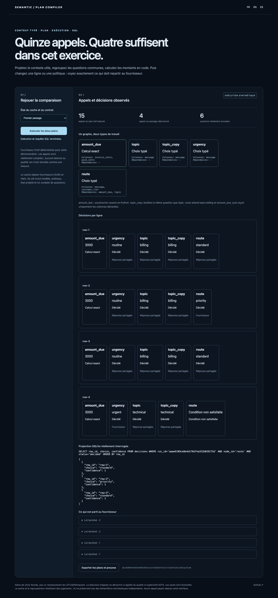

# Semantic Plan Compiler

[Français](README.md) · [Español](README.es.md)

**Compile closed decisions into exact arithmetic, focused questions, human review and traceable SQLite tables.**

A JSON contract declares required columns, allowed choices and dependencies. The compiler validates the graph, computes amounts in code, shares identical questions and batches questions with exactly the same context. Row or policy changes invalidate affected work; insufficient confidence blocks dependent decisions.

## Try without a key

Python 3.11+; demo uses an explicitly synthetic provider.

```sh
git clone https://github.com/gbesse/semantic-plan-compiler
cd semantic-plan-compiler
python3 -m semantic_plan serve --lang en
```

Open `http://127.0.0.1:8774/?lang=en`. Both executors actually run on four synthetic requests. The naive executor makes one call per active semantic cell, without cache or batching; the compiled executor shares common questions and contexts. Counts are not animations.

| Synthetic-provider pass  | Calls | Questions |
| ------------------------ | ----: | --------: |
| Executed naive plan      |    15 |        15 |
| Compiled, cold           |     4 |         6 |
| Same input, warm cache   |     0 |         0 |
| One message changed      |     2 |         3 |
| New policy version       |     4 |         6 |
| Synthetic confidence 0.6 |     2 |         4 |

The last case requires review and blocks all four dependent routes; no route is silently invented. Traces show sent columns and exact questions. Displayed SQL actually queries materialized decisions. JSON export includes both plans, outcomes, provenance and input contract.



```sh
python3 -m semantic_plan demo --lang en
python3 -m semantic_plan run semantic_plan/examples/en.json .local/decisions.sqlite
python3 -m semantic_plan plan contract.json
python3 -m semantic_plan query .local/decisions.sqlite query.sql
```

Create `.local/` before choosing that path. `run` uses a fixture provider; `live` explicitly makes paid requests. `pip install .` also provides `semantic-plan`. FR/EN/ES UI, errors, contracts and examples; user data is never translated.

## Contracts and cache

Two alpha node types: `subtract`, exact subtraction of two integer columns, and `choice`, a closed choice with instructions and descriptions. Dependencies form a DAG; `when` conditions a node on a declared parent choice. Unknown fields, cycles, missing columns and inconsistent types fail validation.

The supplied plan computes `amount_due`, classifies topic, reuses it for `topic_copy`, classifies urgency and routes only invoice requests. Only routing receives `customer_tier`; `unused_private_note` is never sent. Shared answers retain per-row provenance.

Cache entries represent **the entire request**: provider, pinned model, policy version, projected state and full question batch. Changing a question also invalidates its siblings in that batch: model responses could depend on their presence. Synthetic and real providers use separate namespaces; fixture results never become real Jev results. Review thresholds are reapplied locally without claiming calibration. Errors and malformed responses are not cached.

Budgets cap attempted calls, sent questions and request characters. Tokens are reported **after responses**, not predicted as a guarantee. A failed request may have been charged: `usage_complete: false` records that limitation. Valid responses can be cached before a budget is exhausted; reports retain undecided cells. No automatic retries.

SQLite tables: `runs`, `decisions`, `cache`; exact values are stored as text to avoid SQLite integer overflow. `query` is read-only, with an allowed function list, instruction bound and row limit. The database includes decisions and projected contexts; treat it as private local data.

## Explicit Jev execution

```sh
pip install .
mkdir -p .local
# Supply TYPESAFE_API_KEY in the environment; never in the contract.
python3 -m semantic_plan live semantic_plan/examples/en.json .local/live.sqlite
```

Fixed endpoint `https://api.typesafe.ai/v1/systemone`, model `jev-1.13.0`, verified TLS, 30-second timeout, no redirects or retries. CLI caps this pass at four calls and six questions; larger contracts may require review. Library `execute` exposes budgets. [TypeSafe documentation](https://docs.typesafe.ai/primitives/choice). No paid calls from the interface.

[The real trial](docs/live-jev-evidence.json) on four synthetic French requests completed with **four calls, six questions, 1,768 input and 228 output tokens**. This validates integration and materialization, not general classification quality. No naive/compiled Jev comparison on a human-labelled corpus was run. Independent project; not affiliated with TypeSafe AI.

## Existing work and limits

[LOTUS](https://lotus-ai.readthedocs.io/en/latest/core_concepts.html) and [Palimpzest](https://github.com/mitdbg/palimpzest) already offer semantic operators and optimization. This is a **small compiler for verifiable closed contracts**, not their replacement or a validated integrated backend. Its focus is contract → exact context → budget → abstention → SQL provenance, in an installable example.

Caching, common subexpressions and batching reuse judgments; they do not preserve independent stochastic samples. Equivalent outputs are tested only with the fixture provider. Fewer calls do not establish equal quality, latency gains or SOTA superiority. Default 0.8 threshold is illustrative and not human-calibrated. No free generation, general semantic joins, distillation, tool-using agent or production deployment.

## Verify

```sh
python3 -m unittest discover -s tests -v
npm ci
npx playwright install chromium
npm run test:browser
npm run format:check
```

Seventeen tests cover graph validation, budgets, whole-request cache and namespaces, row/policy/batch invalidation, provider errors, large exact integers, review and read-only SQL. Naive execution makes fifteen actual fixture calls and matches compiled values/categories on this exercise. FR/EN/ES browser: five modes, SQL, export, `.env` protection and mobile. Python 3.11/3.12 CI and installed wheel outside source. MIT; public alpha.
